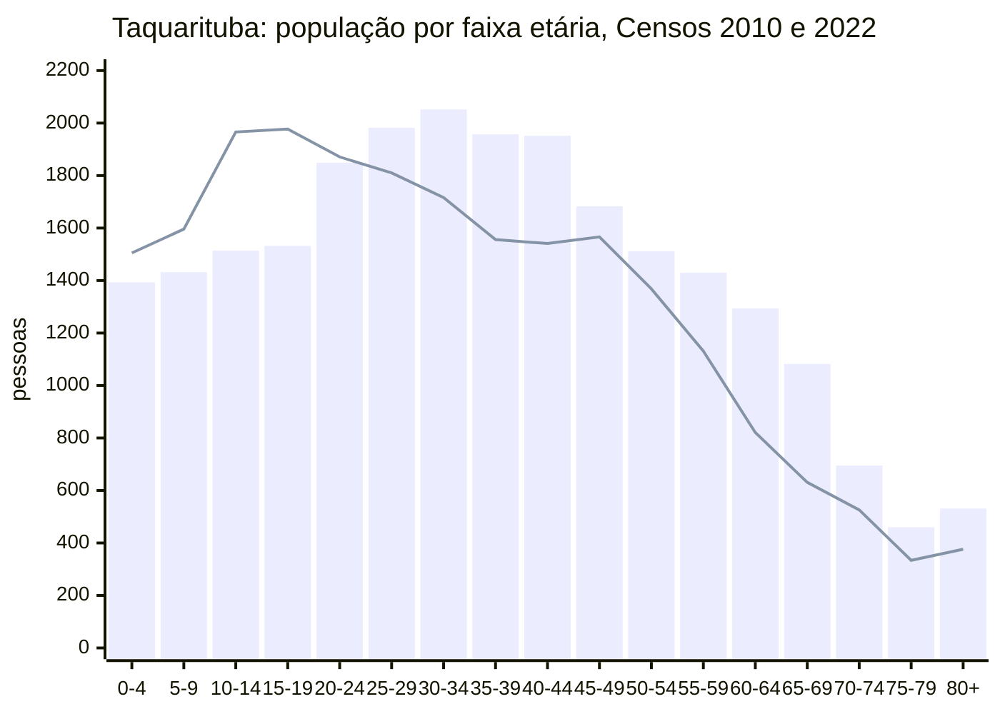

# Taquarituba (SP): pirâmide etária

Legenda: **[oficial]** número publicado pela fonte; **[cálculo]** conta minha só com números oficiais; **[inferência]** interpretação minha.

## 1. Pirâmide do Censo 2022 (faixas quinquenais por sexo)

Fonte dos números absolutos: IBGE, Censo 2022, SIDRA tabela 9514 [oficial, S3]. Percentuais e razão de sexo por faixa: [cálculo].

| Faixa | Homens | Mulheres | Total | % do total | Homens por 100 mulheres |
|---|---:|---:|---:|---:|---:|
| 0 a 4 | 699 | 694 | 1.393 | 5,7 | 100,7 |
| 5 a 9 | 766 | 666 | 1.432 | 5,9 | 115,0 |
| 10 a 14 | 776 | 738 | 1.514 | 6,2 | 105,1 |
| 15 a 19 | 780 | 752 | 1.532 | 6,3 | 103,7 |
| 20 a 24 | 1.012 | 837 | 1.849 | 7,6 | 120,9 |
| 25 a 29 | 1.106 | 876 | 1.982 | 8,1 | 126,3 |
| 30 a 34 | 1.161 | 891 | 2.052 | 8,4 | 130,3 |
| 35 a 39 | 1.097 | 860 | 1.957 | 8,0 | 127,6 |
| 40 a 44 | 1.020 | 932 | 1.952 | 8,0 | 109,4 |
| 45 a 49 | 871 | 812 | 1.683 | 6,9 | 107,3 |
| 50 a 54 | 726 | 786 | 1.512 | 6,2 | 92,4 |
| 55 a 59 | 680 | 750 | 1.430 | 5,9 | 90,7 |
| 60 a 64 | 625 | 669 | 1.294 | 5,3 | 93,4 |
| 65 a 69 | 510 | 572 | 1.082 | 4,4 | 89,2 |
| 70 a 74 | 314 | 381 | 695 | 2,9 | 82,4 |
| 75 a 79 | 222 | 238 | 460 | 1,9 | 93,3 |
| 80 a 84 | 141 | 164 | 305 | 1,3 | 86,0 |
| 85 a 89 | 59 | 81 | 140 | 0,6 | 72,8 |
| 90 a 94 | 30 | 39 | 69 | 0,3 | 76,9 |
| 95 a 99 | 8 | 8 | 16 | 0,1 | 100,0 |
| 100 ou mais | 0 | 1 | 1 | 0,0 | |
| **Total** | **12.603** | **11.747** | **24.350** | 100 | **107,3** |

### Gráfico ASCII (cada # = 25 pessoas)

```
                                         HOMENS  idade   MULHERES
                                                 100+
                                                 95-99
                                              #  90-94  ##
                                             ##  85-89  ###
                                         ######  80-84  #######
                                      #########  75-79  ##########
                                  #############  70-74  ###############
                           ####################  65-69  #######################
                      #########################  60-64  ###########################
                    ###########################  55-59  ##############################
                  #############################  50-54  ###############################
            ###################################  45-49  ################################
      #########################################  40-44  #####################################
   ############################################  35-39  ##################################
 ##############################################  30-34  ####################################
   ############################################  25-29  ###################################
       ########################################  20-24  #################################
                ###############################  15-19  ##############################
                ###############################  10-14  ##############################
                ###############################   5-9   ###########################
                   ############################   0-4   ############################
```

### Comparação 2010 x 2022 (total por faixa)



Barras = 2022; linha = 2010. Fontes: [S3] e [S4]. A faixa 80+ soma as faixas de 80 anos ou mais [cálculo].

Leitura **[inferência]**:

- **Base estreitando**: há menos crianças de 0 a 14 anos em 2022 (4.339) do que em 2010 (5.067), mesmo com mais gente no total [cálculo, S3 e S4]. Reflexo da queda de nascimentos.
- **Bojo masculino de 20 a 44 anos**: entre 20 e 44 anos há 5.396 homens e 4.396 mulheres, cerca de 1.000 homens a mais [cálculo, S3]. Em 2010 essas faixas eram equilibradas [S4]. A SES-SP atribui o predomínio masculino de 20 a 49 anos aos "privados de liberdade residentes no município" [oficial, S7]. A Penitenciária tem 1.241 presos (SAP/SP, 2024) [S7].
- **Topo alargando**: a população de 60 anos ou mais passou de 2.688 (2010) para 4.062 (2022), +51% [cálculo, S3 e S4].

## 2. Pirâmide do Censo 2010 (para comparação)

Fonte: IBGE, Censo 2010, SIDRA tabela 1378 (universo) [oficial, S4]; faixas quinquenais somadas a partir das idades simples [cálculo]. Total 22.291 (11.092 homens e 11.199 mulheres).

| Faixa | Homens | Mulheres | Total |
|---|---:|---:|---:|
| 0 a 4 | 751 | 754 | 1.505 |
| 5 a 9 | 822 | 774 | 1.596 |
| 10 a 14 | 987 | 979 | 1.966 |
| 15 a 19 | 975 | 1.002 | 1.977 |
| 20 a 24 | 976 | 895 | 1.871 |
| 25 a 29 | 888 | 922 | 1.810 |
| 30 a 34 | 880 | 836 | 1.716 |
| 35 a 39 | 767 | 789 | 1.556 |
| 40 a 44 | 732 | 809 | 1.541 |
| 45 a 49 | 762 | 804 | 1.566 |
| 50 a 54 | 700 | 668 | 1.368 |
| 55 a 59 | 542 | 589 | 1.131 |
| 60 a 64 | 438 | 383 | 821 |
| 65 a 69 | 286 | 345 | 631 |
| 70 a 74 | 259 | 267 | 526 |
| 75 a 79 | 162 | 172 | 334 |
| 80 ou mais | 165 | 211 | 376 |

## 3. Indicadores de estrutura etária

| Indicador | Taquarituba 2010 | Taquarituba 2022 | Estado de SP 2022 | Tipo e fonte |
|---|---:|---:|---:|---|
| Idade mediana (anos) | 31 | **36** | 36 | 2022: [oficial, S12]; 2010: [cálculo, S4] |
| % de 0 a 14 anos | 22,7% | 17,8% | 18,0% | [cálculo, S3, S4] |
| % de 15 a 64 anos | 68,9% | 70,8% | 70,1% | [cálculo] |
| % de 60 anos ou mais | 12,1% | 16,7% | 17,2% | [cálculo] |
| % de 65 anos ou mais | 8,4% | 11,4% | 11,9% | [cálculo]; 2010 também no Atlas: 8,37% [S15] |
| Índice de envelhecimento (60+ por 100 de 0 a 14) | 53,0 | **93,62** | 95,93 | 2022: [oficial, S12]; 2010: [cálculo] |
| Índice de envelhecimento (65+ por 100 de 0 a 14) | 36,8 | 63,8 | 66,3 | [cálculo] |
| Razão de dependência total ((0 a 14 + 65+) / 15 a 64) | 45,2 | **41,2** | 42,6 | [cálculo]; 2010 no Atlas: 45,13 [S15] |
| Razão de dependência jovem | 33,0 | 25,2 | 25,6 | [cálculo] |
| Razão de dependência idosa | 12,2 | 16,1 | 17,0 | [cálculo] |
| Razão de sexo (homens por 100 mulheres) | 99,0 | **107,29** | 92,97 | 2022: [oficial, S12]; 2010: [cálculo] |

Atlas Brasil: razão de dependência de 53,65% em 2000 [oficial, S15].

**[inferência]** Os presos (~1.200 homens em idade ativa) inflam o grupo de 15 a 64 anos. Sem eles, a razão de dependência total seria perto de 44 e o índice de envelhecimento não muda (ele não usa a faixa ativa). A idade mediana "civil" seria um pouco maior que 36.

## 4. Comparação regional (Censo 2022)

| Território | Idade mediana | Índice de envelhecimento (60+) | Razão de sexo |
|---|---:|---:|---:|
| **Taquarituba** | 36 | 93,62 | 107,29 |
| Avaré | 36 | 93,85 | 98,06 |
| Itaí | 36 | 79,74 | 107,70 |
| Itaporanga | 38 | 106,17 | 96,47 |
| Coronel Macedo | 39 | 127,95 | 101,98 |
| Taguaí | 33 | 71,74 | 98,14 |
| Fartura | 38 | 115,39 | 95,39 |
| Estado de SP | 36 | 95,93 | 92,97 |
| Brasil | 35 | 80,03 | 94,25 |

Tudo [oficial], IBGE, Censo 2022, SIDRA tabela 10097 [S12].

**[inferência]** Taquarituba está no meio da região: mais jovem que Fartura, Itaporanga e Coronel Macedo (que perdem população e envelhecem mais rápido), mais velha que Taguaí e Itaí. É uma estrutura muito parecida com a média do estado.

## Fontes

- [S3] IBGE, Censo 2022, SIDRA tabela 9514, "População residente, por sexo, idade e forma de declaração da idade". https://sidra.ibge.gov.br/tabela/9514 (consulta via API em 20/10/2026).
- [S4] IBGE, Censo 2010, SIDRA tabela 1378, "População residente, por situação do domicílio, sexo e idade". https://sidra.ibge.gov.br/tabela/1378
- [S7] SES-SP / GVE XVI Botucatu, "Portfólio do município Taquarituba", dez/2024. https://portal.saude.sp.gov.br/resources/ccd/homepage/2025/sim-sinasc/portfolios/gve-16/taquarituba.pdf
- [S12] IBGE, Censo 2022, SIDRA tabela 10097, "Índice de envelhecimento, idade mediana e razão de sexo". https://sidra.ibge.gov.br/tabela/10097
- [S15] Atlas do Desenvolvimento Humano no Brasil (PNUD, Ipea, FJP), perfil de Taquarituba, seção População (Censos 2000 e 2010). https://www.atlasbrasil.org.br/perfil/municipio/355380

Arquivos: `dados/piramide_etaria_2022.csv`, `dados/piramide_etaria_2010.csv`, `dados/comparacao_regional_censo2022.csv`.
