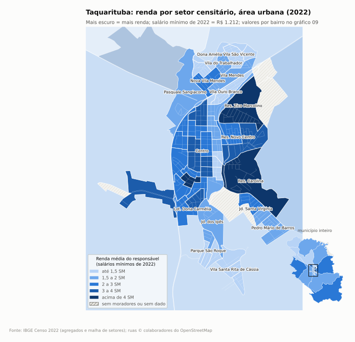

# Taquarituba (SP): análise por bairro

Município IBGE 3553807. Pesquisa feita em 20/10/2026. Ficha detalhada de cada bairro em [bairros.md](bairros.md). Dados em [dados/](dados/).

## Resumo

- **População 2022: 24.350** [IBGE Cidades](https://www.ibge.gov.br/cidades-e-estados/sp/taquarituba.html); 20.421 em setores urbanos e 3.929 em setores rurais, dos quais **1.150 presos** na unidade prisional da SP-255 [IBGE, setores](https://ftp.ibge.gov.br/Censos/Censo_Demografico_2022/Agregados_por_Setores_Censitarios/). Sem o presídio, a população residente fica em 23.200, cerca de 88% urbana.
- **Município de um distrito só, sem bairros oficiais no IBGE.** O IBGE publicou "Agregados por bairro" no Censo 2022, mas Taquarituba não tem nenhum bairro cadastrado (campo vazio nos 76 setores). Por isso o recorte por bairro aqui é reconstruído (método abaixo).
- **Renda:** rendimento médio do responsável pelo domicílio R$ 2.397,43, mediana R$ 1.500 [IBGE, renda por município](https://ftp.ibge.gov.br/Censos/Censo_Demografico_2022/Agregados_por_Setores_Censitarios_Rendimento_do_Responsavel/). Isso é 63% da média paulista (cerca de R$ 3.819, média ponderada dos municípios de SP calculada por mim com o mesmo arquivo) e abaixo de Avaré (R$ 3.233), Piraju (R$ 2.731), Itapeva (R$ 2.669) e Itaí (R$ 2.429); acima de Fartura (R$ 2.325), Taguaí (R$ 2.038) e Tejupá (R$ 1.836).
- **A cidade tem três "faixas" claras [Inferência sobre dado IBGE]:**
  1. **Vetor leste novo, de alta renda:** Residencial Zico Marcolino, Residencial Carolina, Alvorada e Morada do Sol, Novo Centro e Colina Verde, ao longo da Av. Gov. Mario Covas. Média de R$ 3.900 a R$ 5.800.
  2. **Centro e entorno sudoeste:** Centro (alto), Dona Carmélia, Nova Vila Mendes. Média de R$ 2.700 a R$ 3.200, população mais velha.
  3. **Anel popular:** Vila Santa Rita de Cássia, Vila Ouro Branco, Vila São Vicente, Parque São Roque, Dona Amélia, Vila do Trabalhador, Pedro Mário de Barros, Aleixos. Média de R$ 1.400 a R$ 2.000, mediana de 1 salário mínimo na maioria.
- **Infraestrutura básica é quase universal na sede:** água, esgoto em rede, coleta de lixo, pavimento e iluminação passam de 95% em quase todos os setores urbanos [IBGE]. O que diferencia os bairros é **drenagem (bueiro)**: de 3% a 99% conforme o setor. Pior em Vila Santa Rita (15%), Aleixos (10%), Vila São Vicente (29%) e Dona Carmélia (31%).
- **Gargalos fora da sede:** Porto Taquari sem esgoto em rede; zona rural com poço, fossa e coleta de lixo parcial.
- **Habitação social recente:** CDHU "Taquarituba H" (Conjunto Habitacional Moacir Rodrigues de Almeida), 253 casas **entregues em 21/01/2026** na Vila Santa Rita de Cássia, depois de 4.096 famílias inscritas [Prefeitura](https://www.taquarituba.sp.gov.br/noticia/print-noticia/2639/sonho-realizado-prefeitura-e-governo-do-estado-entregam-253-casas-do-cdhu-em-taquarituba/), [CDHU](https://www.cdhu.sp.gov.br/-/taquarituba-recebe-sorteio-de-253-casas-da-cdhu). Fica justamente no bairro de menor renda de 2022 e soma cerca de 700 moradores que o Censo não captou **[Inferência]**.

## Mapa mental da cidade

Coordenadas aproximadas dos centróides dos setores IBGE. Norte para cima. Não é escala.

```
                         [Represa Jurumirim]
   Bairro do Barreiro            .
        (rural)            Porto Taquari (povoado + residencial de lazer)
                                   .
 Aleixos  ....Rod. Alfredo de Oliveira Carvalho....   Rural nordeste
 (núcleo urbano                       \
  + CDHU "Taquarituba V")              \   SP-255 (para Itaí / Avaré)
                                        \
                Pasquale Sangiacomo  ---- entrada norte
                Dona Amélia | Nova Vila Mendes | Vila do Trabalhador
                Vila Mendes | Vila São Vicente
                        Vila Ouro Branco
     Dist. Industrial                     Zico Marcolino   Novo Centro /
     (oeste)        CENTRO (Praça São Roque,              Colina Verde
                    Santa Casa)       Paço Municipal      (Av. Mario Covas)
                    Dona Carmélia                 Residencial Carolina /
                    Jardim dos Ipês               Alvorada / Morada do Sol
                    Parque São Roque              Pedro Mário de Barros
                    (Recinto de Exposições)       Jardim Santa Virgínia
                                                  Vila Santa Rita / Moacir
                                                  (CDHU Taquarituba H)
                            |
                            SP-255 sul
                    Unidade prisional (km 326)        Bairro do Muniz (rural)
                            |
                    para Coronel Macedo / Itaporanga
```

Fontes do desenho: centróides da [malha de setores IBGE 2022](https://ftp.ibge.gov.br/Censos/Censo_Demografico_2022/Agregados_por_Setores_Censitarios/malha_com_atributos/setores/), nomes de lugar do [OpenStreetMap](https://www.openstreetmap.org/#map=14/-23.533/-49.243) e bairros dos Correios via [cepsbrasil](https://cepsbrasil.com.br/sp/taquarituba).

## Ranking por bairro

Todos os números são do Censo 2022 [IBGE](https://ftp.ibge.gov.br/Censos/Censo_Demografico_2022/Agregados_por_Setores_Censitarios/), somados por zona. A atribuição do setor ao bairro é inferência (ver método). Arquivo completo: [dados/bairros_agregado_censo2022.csv](dados/bairros_agregado_censo2022.csv).

### Renda (rendimento médio mensal do responsável, 2022)

| # | Bairro (zona) | Pop. | Renda média | Mediana (faixa) | Alfab. 15+ |
|---|---|---|---|---|---|
| 1 | Residencial Zico Marcolino | 170 | R$ 5.835 | R$ 3.950 | 100% |
| 2 | Res. Carolina / Alvorada / Morada do Sol | 325 | R$ 5.614 | R$ 4.000 | 96,4% |
| 3 | Res. Novo Centro / Colina Verde / Jd. Novo Centro I | 963 | R$ 3.875 | R$ 2.500 a 3.000 | 97,9% |
| 4 | Loteamento Dona Carmélia | 820 | R$ 3.194 | R$ 1.212 a 2.000 | 98,8% |
| 5 | Nova Vila Mendes / Jd. São Pedro | 343 | R$ 3.191 | R$ 2.500 | 98,3% |
| 6 | Centro | 6.456 | R$ 2.715 | R$ 1.212 a 3.175 | 95,7% |
| 7 | Jardim Santa Virgínia | 1.105 | R$ 2.392 | R$ 1.600 a 2.000 | 93,2% |
| 8 | Pasquale Sangiacomo | 309 | R$ 2.319 | R$ 1.885 | 97,4% |
| 9 | Vila Mendes / Conj. Carlos Eduardo Rodrigues | 460 | R$ 2.124 | R$ 1.600 | 96,1% |
| 10 | Jardim dos Ipês e borda sul | 489 | R$ 2.046 | R$ 1.212 | 89,2% |
| 11 | Bairro dos Aleixos (núcleo + entorno) | 1.031 | R$ 2.013 | R$ 1.300 a 2.000 | 89,9% |
| 12 | Pedro Mário de Barros | 1.243 | R$ 1.976 | R$ 1.600 a 2.000 | 96,4% |
| 13 | Vila do Trabalhador | 586 | R$ 1.904 | R$ 1.300 | 93,0% |
| 14 | Conj. Hab. Dona Amélia Firmo de Melo | 838 | R$ 1.708 | R$ 1.212 a 1.500 | 93,7% |
| 15 | Parque São Roque | 1.843 | R$ 1.693 | R$ 1.212 a 1.500 | 94,0% |
| 16 | Vila São Vicente | 1.310 | R$ 1.657 | R$ 1.212 a 1.435 | 90,6% |
| 17 | Vila Ouro Branco | 1.012 | R$ 1.487 | R$ 1.212 | 93,4% |
| 18 | Vila Santa Rita de Cássia / Moacir R. de Almeida | 1.297 | R$ 1.407 | R$ 1.212 | 88,8% |

Município: R$ 2.397 (mediana R$ 1.500). Porto Taquari (R$ 2.676, puxado por 6 domicílios de veraneio) e as zonas rurais ficam fora do ranking urbano; estão no CSV e em [bairros.md](bairros.md).

**Setores extremos:** maior renda média em setor com mais de 50 domicílios: 0077 Zico Marcolino (R$ 5.835) e 0079 Carolina/Alvorada (R$ 5.614), seguidos de 0090 no Centro (R$ 4.929, Rua 24 de Dezembro, Joaquim Gabriel, Presidente Kennedy). Menor: 0098 (R$ 1.264) e 0099 (R$ 1.315), ambos na Vila Santa Rita de Cássia, e 0074 (R$ 1.353) na Vila São Vicente.

### Infraestrutura urbana (Censo 2022, entorno dos domicílios)

Índice = média simples de 7 itens (% de domicílios com: água de rede, esgoto em rede ou fossa ligada à rede, lixo coletado, via pavimentada, iluminação pública, bueiro na face, calçada). Só setores urbanos têm dado de entorno.

| Bairro | Índice | Bueiro | Pavim. | Ilum. | Calçada | Esgoto |
|---|---|---|---|---|---|---|
| Parque São Roque | 97,8 | 84,5% | 100% | 100% | 100% | 100% |
| Conj. Hab. Dona Amélia | 97,7 | 85,1% | 100% | 100% | 100% | 99,7% |
| Res. Zico Marcolino | 97,5 | 95,2% | 100% | 100% | 93,5% | 96,8% |
| Jardim dos Ipês e borda sul | 94,4 | 68,6% | 97,5% | 100% | 97,5% | 97,5% |
| Res. Carolina / Alvorada | 93,7 | 76,9% | 100% | 100% | 95,7% | 91,5% |
| Nova Vila Mendes / Jd. São Pedro | 93,6 | 55,1% | 100% | 100% | 100% | 100% |
| Vila do Trabalhador | 92,9 | 50,2% | 100% | 100% | 100% | 100% |
| Res. Novo Centro / Colina Verde | 92,7 | 49,8% | 100% | 99,4% | 100% | 99,7% |
| Vila Ouro Branco | 92,4 | 49,5% | 99,5% | 98,4% | 99,5% | 100% |
| Jardim Santa Virgínia | 92,1 | 45,7% | 99,7% | 99,7% | 99,7% | 99,7% |
| Vila Mendes / Conj. Carlos Eduardo | 92,0 | 50,0% | 97,0% | 97,0% | 100% | 100% |
| Pedro Mário de Barros | 91,9 | 43,3% | 100% | 100% | 100% | 100% |
| Centro | 90,7 | 43,5% | 98,8% | 98,2% | 95,5% | 99,4% |
| Vila São Vicente | 89,8 | 28,9% | 100% | 100% | 99,6% | 99,8% |
| Pasquale Sangiacomo | 88,9 | 52,1% | 99,1% | 97,4% | 88,0% | 93,2% |
| Loteamento Dona Carmélia | 88,6 | 31,2% | 100% | 100% | 99,3% | 95,5% |
| Vila Santa Rita de Cássia / Moacir | 87,8 | 14,9% | 100% | 100% | 100% | 100% |
| Bairro dos Aleixos | 78,8 | 10,3% | 100% | 99,0% | 100% | 79,6% |
| Porto Taquari (só 0027) | 52,6 | 0% | 100% | 83,3% | 0% | 0% |

**Leitura [Inferência]:** pavimento, luz e esgoto não separam os bairros da sede; o que separa é a drenagem. Bairros com bueiro abaixo de 30% (Vila Santa Rita, Aleixos, São Vicente, Dona Carmélia, e setores do Centro como 0065, 0022 e 0090) são os candidatos naturais a reclamação de alagamento e enxurrada. Os pedidos de escoamento na Câmara confirmam em parte (ver seção de problemas).

## Histórico: 2010 x 2022 e linha do tempo da expansão

**Como comparei.** A malha de setores mudou entre os censos (40 setores em 2010, 76 em 2022). Baixei o Censo 2010 por setor [IBGE 2010, universo por setor](https://ftp.ibge.gov.br/Censos/Censo_Demografico_2010/Resultados_do_Universo/Agregados_por_Setores_Censitarios/) e a malha de 2010 [IBGE geoftp](https://geoftp.ibge.gov.br/organizacao_do_territorio/malhas_territoriais/malhas_de_setores_censitarios__divisoes_intramunicipais/censo_2010/setores_censitarios_shp/sp/), sobrepus os polígonos e joguei cada setor de 2010 inteiro na macrorregião de 2022 onde ele cai. Por isso a comparação é por **macrorregião**, não por bairro fino. Renda em salários mínimos (SM de R$ 510 em 2010 e R$ 1.212 em 2022) para tirar o efeito da inflação. Atenção: o salário mínimo teve ganho real no período, então renda estável em SM ainda é ganho real. Cuidado também com a renda de 2010, que aqui é ponderada por domicílio.

| Macrorregião | Moradores 2010 | Pop. 2022 | Domicílios 2010 | Domicílios 2022 | Var. domic. | Renda 2010 (SM) | Renda 2022 (SM) |
|---|---|---|---|---|---|---|---|
| A. Núcleo antigo (Centro, Dona Carmélia, Jd. dos Ipês, Ouro Branco) | 10.091 | 8.777 | 3.287 | 3.371 | +2,6% | 2,52 | 2,14 |
| B. Zona norte popular (Dona Amélia, Vila Mendes, Nova Vila Mendes, Vila do Trabalhador, São Vicente, Pasquale) | 3.740 | 3.846 | 1.080 | 1.359 | +25,8% | 1,77 | 1,61 |
| C. Zona sul e sudeste (Parque São Roque, Santa Virgínia, Pedro Mário de Barros, Santa Rita) | 4.291 | 5.488 | 1.252 | 1.883 | +50,4% | 1,55 | 1,51 |
| D. Vetor leste (Novo Centro, Colina Verde, Zico Marcolino, Carolina, Alvorada) | 808 | 1.458 | 260 | 508 | +95,4% | 2,57 | 3,73 |
| E. Bairro dos Aleixos | 1.105 | 1.031 | 348 | 363 | +4,3% | 1,34 | 1,66 |
| F. Rural, Porto Taquari e Distrito Industrial | 2.189 | 2.600 | 645 | 888 | +37,7% | 1,97 | 1,97 |
| G. Unidade prisional | 0 | 1.150 | 0 | 0 | | | |
| **Município** | **22.224** | **24.350** | **6.872** | **8.372** | **+21,8%** | **2,11** | **1,98** |

"Moradores 2010" são moradores em domicílios particulares permanentes (variável V002 de 2010); a população de 2022 é a total. Dados: [comparacao_2010_2022_macroregioes.csv](dados/comparacao_2010_2022_macroregioes.csv), [setores_censitarios_2010_taquarituba.csv](dados/setores_censitarios_2010_taquarituba.csv) e, em nível de bairro com rateio por área ponderado por densidade (menos confiável), [comparacao_2010_2022_por_bairro.csv](dados/comparacao_2010_2022_por_bairro.csv).

**Leitura [Inferência sobre dado IBGE]:**

- A cidade cresceu para o **sul/sudeste** (popular) e para o **leste** (alta renda). O núcleo antigo perdeu moradores mas não casas: envelhecimento e famílias menores.
- O vetor leste dobrou e passou de 2,6 para 3,7 salários mínimos. Os loteamentos Novo Centro (ruas nomeadas em 2000) e Colina Verde (2004) são anteriores, então a década foi de **ocupação e adensamento** dessas áreas por famílias de renda mais alta, mais os residenciais Zico Marcolino, Carolina e Alvorada, que não têm lei de denominação localizada.
- **Pedro Mário de Barros** não existia como bairro urbano em 2010: a área era o setor rural 030. Em 2022 tinha 395 domicílios.
- A desigualdade entre bairros aumentou: em 2010 a diferença de renda entre o vetor leste e a zona sul era de 1,7 vez; em 2022, 2,5 vezes.
- A população presa (1.150) equivale a mais da metade da diferença entre os 22.224 moradores de domicílios de 2010 e os 24.350 habitantes de 2022. Fora o presídio, o crescimento de moradores foi modesto; o de domicílios (+22%) foi bem maior. A penitenciária foi inaugurada em 26/12/2014 [SAP](https://www1.sap.sp.gov.br/noticias/not454.html).

**Linha do tempo da expansão (o que deu para datar):**

| Período | Fato | Fonte |
|---|---|---|
| 16/12/1991 | Ruas do loteamento **Parque São Roque** nomeadas | [Lei 936, 16/12/1991](https://camarataquarituba.sp.gov.br/index1.php?pag=T0dRPU9EZz1PR009T1RnPQ&id=945&idtipolei=1) |
| 14/04 e 28/04/1992 | "Conjunto Habitacional Taquarituba A", à margem da SP-255, vira **Conj. Hab. Pasquale Sangiacomo** e tem as ruas nomeadas | [Lei 945, 28/04/1992](https://camarataquarituba.sp.gov.br/index1.php?pag=T0dRPU9EZz1PR009T1RnPQ&id=905&idtipolei=1) |
| 26/04/1994 | Área no acesso ao Bairro dos Aleixos entra no perímetro urbano | Lei 1.008/1994, [leis da Câmara](https://camarataquarituba.sp.gov.br/) |
| 05/11/1996 | "Conj. Hab. Taquarituba B1/B2" vira **Carlos Eduardo Rodrigues** e "Conj. Hab. Taquarituba C", à margem da vicinal Orvalino Marcelino da Costa, vira **Dona Amélia Firmo de Melo** | [Lei 1.069, 05/11/1996](https://camarataquarituba.sp.gov.br/index1.php?pag=T0dRPU9EZz1PR009T1RnPQ&id=684&idtipolei=1) |
| 16/11/2000 | 17 ruas do **Residencial Novo Centro** nomeadas | [Lei 1.255, 16/11/2000](https://camarataquarituba.sp.gov.br/index1.php?pag=T0dRPU9EZz1PR009T1RnPQ&id=334&idtipolei=1) |
| 20/12/2002 e 17/02/2003 | Gleba do Bairro Lageado, na continuação da Av. Dorival Dognani, entra no perímetro urbano | Leis 1.361/2002 e 1.363/2003, [leis da Câmara](https://camarataquarituba.sp.gov.br/) |
| 03/06/2004 | Ruas do **Colina Verde** nomeadas | [Lei 1.398, 03/06/2004](https://camarataquarituba.sp.gov.br/index1.php?pag=T0dRPU9EZz1PR009T1RnPQ&id=220&idtipolei=1), [Lei 1.399, 03/06/2004](https://camarataquarituba.sp.gov.br/index1.php?pag=T0dRPU9EZz1PR009T1RnPQ&id=219&idtipolei=1) |
| 29/04/2008 | Rua do **Loteamento Bela Vista** nomeada | [Lei 1.510, 29/04/2008](https://camarataquarituba.sp.gov.br/index1.php?pag=T0dRPU9EZz1PR009T1RnPQ&id=116&idtipolei=1) |
| Antes de 2010 | Já eram urbanos no Censo 2010: Centro, Dona Carmélia, Ouro Branco, Vila São Vicente, Vila do Trabalhador, Vila Mendes, Dona Amélia, Parque São Roque, Santa Virgínia, Vila Santa Rita, núcleo dos Aleixos e o núcleo "Taquarituba V" (14 domicílios) | [IBGE 2010](https://ftp.ibge.gov.br/Censos/Censo_Demografico_2010/Resultados_do_Universo/Agregados_por_Setores_Censitarios/) |
| 2010 a 2022 | Surgem ou se adensam Pedro Mário de Barros (antes rural), os residenciais do vetor leste e o Jardim dos Ipês; Santa Virgínia cresce 77% em domicílios | comparação IBGE 2010 x 2022 |
| 26/12/2014 | Inauguração da Penitenciária de Taquarituba, SP-255 km 326 | [SAP](https://www1.sap.sp.gov.br/noticias/not454.html) |
| 18/02/2016 | **Vila Santa Rita de Cássia** formalizada: lotes do Parque São Roque na margem direita do Córrego Lageado, quadras 17 a 35 (o nome já aparecia em lei de 2011) | [Lei 1.745, 18/02/2016](https://camarataquarituba.sp.gov.br/index1.php?pag=T0dRPU9EZz1PR009T1RnPQ&id=1133&idtipolei=1) |
| 02/03/2022 | Ruas do **Residencial Jurema** nomeadas | [Lei 1.872, 02/03/2022](https://camarataquarituba.sp.gov.br/index1.php?pag=T0dRPU9EZz1PR009T1RnPQ&id=1489&idtipolei=1) |
| 30/03/2022 | Nome do loteamento **Moacir Rodrigues de Almeida** (área do CDHU Taquarituba H) e de 15 ruas | [Lei 1.879, 30/03/2022](https://camarataquarituba.sp.gov.br/index1.php?pag=T0dRPU9EZz1PR009T1RnPQ&id=1501&idtipolei=1) |
| 15/09/2022 | Ruas do **Loteamento Altos da Cidade** nomeadas | [Lei 1.892, 15/09/2022](https://camarataquarituba.sp.gov.br/index1.php?pag=T0dRPU9EZz1PR009T1RnPQ&id=1521&idtipolei=1) |
| 2022 | Censo registra setor urbano sem morador ao longo da Av. Mário Covas (0111). **[Inferência]** Jurema e Altos da Cidade, nomeados em 2022, ainda não tinham moradores na coleta | [IBGE 2022](https://ftp.ibge.gov.br/Censos/Censo_Demografico_2022/Agregados_por_Setores_Censitarios/) |
| 2022 | Estado autoriza licitação de R$ 9,89 milhões para urbanizar o loteamento do CDHU Taquarituba H | [abcdoabc](https://abcdoabc.com.br/sp-autoriza-construcao-de-498-moradias-na-regiao-de-itapeva/), [Prefeitura](https://www.taquarituba.sp.gov.br/noticia/2362/governo-de-sao-paulo-autoriza-a-construcao-de-253-moradias-atraves-do-cdhu/) |
| 03/07/2024 | Ordem de serviço das 253 casas | [Prefeitura](https://www.taquarituba.sp.gov.br/noticia/2562/ordem-de-servico-para-construcao-de-253-unidades-habitacionais-em-taquarituba-e-assinada-na-cdhu/) |
| Maio e 22/09/2025 | Inscrições (4.096 famílias) e sorteio | [CDHU](https://www.cdhu.sp.gov.br/-/taquarituba-recebe-sorteio-de-253-casas-da-cdhu) |
| 23/12/2025 | Câmara autoriza doar 23.598,50 m² ao FAR/Caixa, de frente para a Rua José Maria Tomasi, para **Minha Casa Minha Vida**; outra lei isenta tributos de imóveis de programas habitacionais. **[Inferência]** a Rua José Maria Tomazi é a das escolas do Bairro dos Aleixos, então o MCMV deve ir para lá. Não achei notícia de obra ou sorteio | [Lei 1.999, 23/12/2025](https://camarataquarituba.sp.gov.br/index1.php?pag=T0dRPU9EZz1PR009T1RnPQ&id=1726&idtipolei=1), Lei 2.000/2025 |
| 21/01/2026 | Entrega do Conjunto Moacir Rodrigues de Almeida (Taquarituba H), 253 casas | [Prefeitura](https://www.taquarituba.sp.gov.br/noticia/print-noticia/2639/sonho-realizado-prefeitura-e-governo-do-estado-entregam-253-casas-do-cdhu-em-taquarituba/) |
| 04/02/2026 | Inauguração do CRAS Carlos Eduardo Rodrigues | [Prefeitura](https://www.taquarituba.sp.gov.br/noticia/2640/assistencia-social-mais-perto-de-voce-prefeitura-inaugura-novo-cras-carlos-eduardo-rodrigues) |

Fonte das leis: leis ordinárias da Câmara, 1985 a 2026, raspadas e lidas pelo [site da Câmara](https://camarataquarituba.sp.gov.br/). Lei de denominação mostra que o conjunto ou loteamento já existia na data, não a data de entrega das casas. **[Inferência]** a sequência "Taquarituba A" (1992), "B1/B2" e "C" (1996), "H" (2022 a 2026) segue o padrão de batismo da CDHU, o que indica que Pasquale Sangiacomo, Carlos Eduardo Rodrigues e Dona Amélia são conjuntos CDHU dos anos 1990. Sem lei de denominação achada: Pedro Mário de Barros, Zico Marcolino, Residencial Carolina, Residencial Alvorada, Jardim dos Ipês e Conj. Dona Maria Antonia Ferme Sangiacomo. Também há leis autorizativas de 2024 para o Bairro dos Aleixos (extensão da Farmácia Municipal, ambulância e base da GCM, Leis 1.958 a 1.960 de 04/10/2024) e para unidade de saúde no Porto Taquari (Lei 1.963, de 01/11/2024).

## Método

1. **Base estatística.** Baixei do FTP do IBGE os agregados por setor censitário do Censo 2022 (básico, demografia, alfabetização, cor ou raça, características do domicílio partes 1 a 3, rendimento do responsável e entorno dos domicílios) e a malha geográfica de setores de SP (GeoPackage), e filtrei os 76 setores de Taquarituba (código 355380705...). Links: [setores](https://ftp.ibge.gov.br/Censos/Censo_Demografico_2022/Agregados_por_Setores_Censitarios/), [renda](https://ftp.ibge.gov.br/Censos/Censo_Demografico_2022/Agregados_por_Setores_Censitarios_Rendimento_do_Responsavel/), [entorno](https://ftp.ibge.gov.br/Censos/Censo_Demografico_2022/Agregados_por_Setores_Censitarios_Caracteristicas_urbanisticas_do_entorno_dos_domicilios/), [malha](https://ftp.ibge.gov.br/Censos/Censo_Demografico_2022/Agregados_por_Setores_Censitarios/malha_com_atributos/setores/gpkg/UF/SP/).
2. **Bairros.** Como o IBGE não tem bairros para Taquarituba, usei a lista dos Correios (32 bairros e as ruas de cada um) via [cepsbrasil.com.br](https://cepsbrasil.com.br/sp/taquarituba).
3. **Setor para bairro.** Baixei as ruas do OpenStreetMap ([Overpass](https://www.openstreetmap.org/#map=14/-23.533/-49.243)), cortei cada rua em trechos de 20 m, descobri em qual polígono de setor cai cada trecho e somei os metros de rua por setor. Cada rua foi casada com o(s) bairro(s) dos Correios que a contêm. O bairro com mais metros de rua no setor é o bairro do setor. Os votos estão no CSV de setores (coluna `bairros_correios_votos`). Os pontos de "bairro" do OSM (place=suburb) caíram nos setores esperados (ex.: "Jardim São Roque" no 0116, "Jardim Dona Amélia" no 0068, "Santa Virgínia" no 0091), o que confirma a atribuição.
4. **Agregação.** Somei contagens por zona. Para renda, a média da zona é ponderada pelo número de responsáveis por domicílio (aproximação, porque o IBGE pondera pelos responsáveis com rendimento, que não vem no arquivo). Mediana não se soma, então mostro a faixa entre setores.
5. **Limites.**
   - Setor censitário não respeita divisa de bairro. Onde um setor mistura bairros, juntei os bairros numa zona só (ex.: Novo Centro com Colina Verde).
   - Bairros dos Correios sem setor habitado casado: Jardim Bela Vista (rua nomeada em 2008), Loteamento Altos da Cidade e Residencial Jurema (ambos de 2022). Os dois últimos provavelmente posteriores a 2022.
   - Setor com poucos domicílios (ex.: 0027 com 6) gera número instável. Sinalizei.
   - Valores "X" (sigilo do IBGE) entram como zero nas somas de saneamento; afetam poucos setores rurais.
   - Censo 2010 por setor não foi usado: a malha mudou e os códigos de setor de 2010 não batem com 2022.
6. **Dado oficial e inferência.** Em todas as fichas, número com [IBGE], [Correios] ou [CDHU] é transcrição de fonte. Texto marcado **[Inferência]** é leitura minha.

## Equipamentos públicos

Fontes: saúde pela [API de dados abertos do CNES](https://apidadosabertos.saude.gov.br/cnes/estabelecimentos?codigo_municipio=355380) (consulta 20/10/2026); escolas pelo [escol.as](https://www.escol.as/cidades/3866-taquarituba), base Censo Escolar 2024; assistência social pelo [site da Prefeitura](https://www.taquarituba.sp.gov.br/prefeitura/telefones). O bairro é o informado pela fonte.

| Bairro | Saúde | Educação | Assistência / outros |
|---|---|---|---|
| Centro | UBS Central (Av. 9 de Julho, 45), Santa Casa (R. Mal. Floriano Peixoto, 95), SAMU (R. Natal José Bortotti, 203), Vigilância Sanitária | EE José Penna, EE Prof. Guido Dias de Almeida, ETEC Profa. Terezinha Monteiro dos Santos, EM Profa. Julieta Trindade Evangelista, EM Profa. Virgínia Ottilia Mascarenhas de Moraes, Casa da Criança (filantrópica) | CREAS (R. São Benedito, 595), CRAS 13 de Maio (endereço só em agregador), Biblioteca/Cultura, Defesa Civil, Casa da Lavoura |
| Novo Centro / Colina Verde | ESF Novo Centro (Av. Mário Covas, 125) | EM Profa. Bernadete de Lourdes Gomes Cláudio | **Paço Municipal (Av. Gov. Mário Covas, 1915)**, Coord. de Ação Social, SCFV/Criança Esperança, Coord. de Educação |
| Jardim Santa Virgínia | ESF Santa Virgínia (R. Ver. Rubens Bueno, 59) | | |
| Pedro Mário de Barros | | EM Maria Esther Di Paschoal | |
| Vila Santa Rita de Cássia | | EE Dr. José Pires de Carvalho, EM Profa. Maria de Lourdes M. Rolim dos Santos, EMEI Profa. Jacyra Lopes Rodrigues | |
| Parque São Roque | ESF Parque São Roque (R. José Boaventura Leitão, 34) | EMEI Parque São Roque | CRAS Parque São Roque (endereço só em agregador) |
| Vila São Vicente / Dona Amélia | ESF Vila São Vicente (R. Tejupá, 140), Lar São Vicente de Paulo (ILPI) | EE Prof. Dimas Mozart e Silva, EMEI Vila São Vicente | Núcleo de Apoio Vila São Vicente (sem endereço) |
| Vila do Trabalhador | CAPS I (R. Manduri) | | |
| Conj. Carlos Eduardo Rodrigues / Vila Mendes | | | **CRAS Carlos Eduardo Rodrigues, inaugurado em 04/02/2026** [Prefeitura](https://www.taquarituba.sp.gov.br/noticia/2640/assistencia-social-mais-perto-de-voce-prefeitura-inaugura-novo-cras-carlos-eduardo-rodrigues) |
| Vila Ouro Branco | | EMEI Áurea Lamarca | |
| Jardim dos Ipês | APAE (Av. Mário Covas, 3151) | Escola Mundo Mágico (APAE) | |
| Jardim Bela Vista | | | Centro de Convivência do Idoso Nair Camargo da Costa [Prefeitura](https://www.taquarituba.sp.gov.br/noticia/2367/prefeitura-de-taquarituba-retoma-atividades-do-centro-de-convivencia-do-idoso-) |
| Distrito Industrial | | | Garagem e almoxarifado de Obras (Av. Dorival Dognani, 1087); armazéns e revendas agrícolas |
| Aleixos | ESF Bairro dos Aleixos (R. Joaquim Rodrigues Primo) | EE Prof. José Aparecido Castelucci, EM Profa. Célia de Castilhos Ferreira | Núcleo de Apoio Aleixo (sem endereço) |
| Bairro do Barreiro (rural) | | EM Profa. Benedita Maria do Rosário Sales (Fazenda Garbelotti) | |
| Penitenciária (SP-255) | Ambulatório prisional | Escola da Penitenciária (EJA) | |
| **Sem nenhum equipamento achado** | Zico Marcolino, Carolina/Alvorada, Dona Carmélia, Pasquale Sangiacomo, Porto Taquari, Bairro do Muniz e demais rurais | | |

Links por escola e por unidade de saúde estão em [bairros.md](bairros.md). **Penitenciária de Taquarituba** (SAP, masculina, regime fechado, inaugurada em 26/12/2014): capacidade de 847 vagas e 1.236 presos em 27/03/2025, cerca de 146% de ocupação [SAP, população prisional](https://www1.sap.sp.gov.br/js/pop-pri.js), [SAP, unidade](https://www1.sap.sp.gov.br/noticias/not454.html).

**Leitura [Inferência]:** os bairros populares da sede têm ESF e escola perto. Os vazios de equipamento estão nos loteamentos novos de alta renda (que usam o Centro) e no rural disperso. O Censo 2022 mostra Vila Santa Rita como o bairro de menor renda e menor alfabetização da sede; ele tem escola e creche, mas não tem ESF própria no CNES (a mais próxima é a Santa Virgínia).

Lacunas: endereço oficial dos CRAS 13 de Maio e Parque São Roque; IDEB por escola não consultado (QEdu bloqueou); escolas rurais Almerinda Ferraz Silva (Bairro dos Nunes) e Pe. Caetano Chibbaro (Aleixos) aparecem sem etapa no escol.as, podem estar paralisadas.

## Problemas recorrentes citados na imprensa e na Câmara

**Fonte principal:** todas as Indicações, Requerimentos e Moções da Câmara Municipal de 2020 a 2026, raspadas do [site da Câmara](https://camarataquarituba.sp.gov.br/) (1.481 itens, com link um a um em [dados/camara_proposicoes_2020_2026.csv](dados/camara_proposicoes_2020_2026.csv)); notícias do [site da Prefeitura](https://www.taquarituba.sp.gov.br/); imprensa regional ([Sudoeste Paulista](https://sudoestepaulista.com.br/), [Portal 014](https://portal014.com.br/), [Avaré Notícias](https://avarenoticias.com.br/)). Indicação é pedido de vereador: mostra demanda, não prova o problema nem diz se foi resolvido. Tratei repetição como sinal de demanda que volta.

**Bairros mais citados na Câmara, 2020 a 2026** (contagem por menção ao nome do bairro na ementa; um item pode citar mais de um bairro):

| Bairro | Proposições | Tema dominante |
|---|---|---|
| Vila São Vicente | 54 | lombadas (R. Barão de Antonina 6 vezes), água parada, posto de saúde, creche |
| Parque São Roque | 53 | recape, bueiro, iluminação, córrego Lajeado, ônibus |
| Bairro dos Aleixos | 45 | ronda policial, farmácia, celular, lazer, transporte |
| Vila Santa Rita de Cássia | 34 | estrada para o Pedro Barros, lombadas, lixo, CDHU |
| Pedro Mário de Barros | 32 | lombadas, creche, ônibus |
| Bairro do Barreiro | 19 | estrada rural, água, lajotas |
| Novo Centro | 18 | iluminação, tapa-buraco, passarela |
| Centro | 17 | drenagem, trânsito, Praça São Roque |
| Vila Ouro Branco, Zico Marcolino, Porto Taquari | 16 cada | praça e luz; Correios e recape; lajotas e água |
| Jardim Santa Virgínia | 15 | buracos, lombadas, guaritas |
| Distrito Industrial | 11 | avenida, trevo, ônibus |
| Dona Amélia ("Vila Amélia") | 10 | posto de saúde, escoamento |

Nenhuma citação para Jardim São Pedro, Residencial Alvorada, Colina Verde, Altos da Cidade, Morada do Sol e penitenciária.

**Temas da cidade:**

- **Água (Sabesp):** crise de cerca de um mês e meio, com cortes diários e água barrenta e com cheiro, no fim de 2024 [Sudoeste Paulista, 19/12/2024](https://sudoestepaulista.com.br/ha-mais-de-um-mes-alem-de-interrupcoes-no-fornecimento-sabesp-entrega-para-taquarituba-agua-barrenta-e-fetida/), [Portal 014, 20/12/2024](https://portal014.com.br/moradores-de-taquarituba-reclamam-de-agua-marrom-nas-torneiras/). Em 2025 a Câmara pediu levantamento das famílias rurais sem água ([Req 11058](https://camarataquarituba.sp.gov.br/index1.php?pag=T0RVPU9UST1PRFk9T1dFPU9UST1PR009T1RVPU9XUT1PVGc9T1dVPU9HRT1PVFk9T1dJPU9UTT0=&id=11058&tpBusca=requerimento)).
- **Asfalto e lajota:** Programa Novo Asfalto (2021 e 2022) trocou lajota por asfalto no Centro e na Vila São Vicente ([Prefeitura 2122](https://www.taquarituba.sp.gov.br/noticia/print-noticia/2122/x/), [Prefeitura 2152](https://www.taquarituba.sp.gov.br/noticia/print-noticia/2152/x/), [Prefeitura 2352](https://www.taquarituba.sp.gov.br/noticia/print-noticia/2352/x/)); contrato de pavimentação e recape com vigência de 08/2025 a 01/2026 [Diário Oficial ed. 1639/2025](https://taquarituba.sp.gov.br/public/admin/globalarq/diario-eletronico/diario/TR3A3aAw2Zsx2A2c.pdf). Tapa-buraco aparece em quase todo bairro todo ano.
- **Lombada e trânsito:** o pedido mais repetido da Câmara.
- **Transporte:** a Tarifa Zero existe; em 2025 e 2026 a pressão é por itinerários novos (Ouro Branco, Aleixos, Pedro Barros, Santa Virgínia, conjunto CDHU novo, Distrito Industrial) e ponto de integração no Centro ([Ind 13835](https://camarataquarituba.sp.gov.br/index1.php?pag=T0RVPU9UST1PRFk9T1dFPU9UST1PR009T1RVPU9XUT1PVGc9T1dVPU9HRT1PVFk9T1dJPU9UTT0=&id=13835&tpBusca=indicacao), [Ind 13836](https://camarataquarituba.sp.gov.br/index1.php?pag=T0RVPU9UST1PRFk9T1dFPU9UST1PR009T1RVPU9XUT1PVGc9T1dVPU9HRT1PVFk9T1dJPU9UTT0=&id=13836&tpBusca=indicacao), [Ind 13844](https://camarataquarituba.sp.gov.br/index1.php?pag=T0RVPU9UST1PRFk9T1dFPU9UST1PR009T1RVPU9XUT1PVGc9T1dVPU9HRT1PVFk9T1dJPU9UTT0=&id=13844&tpBusca=indicacao), [Ind 13820](https://camarataquarituba.sp.gov.br/index1.php?pag=T0RVPU9UST1PRFk9T1dFPU9UST1PR009T1RVPU9XUT1PVGc9T1dVPU9HRT1PVFk9T1dJPU9UTT0=&id=13820&tpBusca=indicacao)).
- **Segurança:** operações contra tráfico em 2025 na Ouro Branco (31/01), Vila Amélia (14/03) e Parque São Roque/Santa Rita (20/06) [Avaré Notícias](https://avarenoticias.com.br/operacao-em-taquarituba-prende-quatro-por-trafico-de-drogas/), [Sudoeste Paulista](https://sudoestepaulista.com.br/operacao-medellin-da-policia-civil-atinge-trafico-de-drogas-em-taquarituba/); roubo no Novo Centro (21/03/2025). Câmara questiona contrato das câmeras de monitoramento ([Req 10972](https://camarataquarituba.sp.gov.br/index1.php?pag=T0RVPU9UST1PRFk9T1dFPU9UST1PR009T1RVPU9XUT1PVGc9T1dVPU9HRT1PVFk9T1dJPU9UTT0=&id=10972&tpBusca=requerimento), [Req 11029](https://camarataquarituba.sp.gov.br/index1.php?pag=T0RVPU9UST1PRFk9T1dFPU9UST1PR009T1RVPU9XUT1PVGc9T1dVPU9HRT1PVFk9T1dJPU9UTT0=&id=11029&tpBusca=requerimento), [Req 11063](https://camarataquarituba.sp.gov.br/index1.php?pag=T0RVPU9UST1PRFk9T1dFPU9UST1PR009T1RVPU9XUT1PVGc9T1dVPU9HRT1PVFk9T1dJPU9UTT0=&id=11063&tpBusca=requerimento)). A SSP-SP só publica crime por município, não por bairro.
- **Saúde:** maior volume de pedidos da cidade (131 itens): falta de remédio, horário da Farmácia Municipal, plantonista e repasse à Santa Casa, especialistas. CAPS I inaugurado em 14/06/2024 ([Prefeitura 2556](https://www.taquarituba.sp.gov.br/noticia/print-noticia/2556/x/)).
- **Chuva e drenagem:** não achei enchente grande documentada. Há temporais com queda de árvores (03/11/2023, 14/11/2023, 21/02/2026 com 90 mm, 01/10/2026) e alagamentos pontuais (R. Itararé na São Vicente, R. Francisco de Lúcia, R. João A. Machado no Lageado) ([Prefeitura 2641](https://www.taquarituba.sp.gov.br/noticia/print-noticia/2641/x/), [Prefeitura 2676](https://www.taquarituba.sp.gov.br/noticia/print-noticia/2676/x/)). **[Inferência]** bate com o mapa de bueiros do Censo: os pedidos de escoamento vêm de bairros com bueiro abaixo de 50%.
- **Política:** existe a "CPI 001.2026" no site da Câmara; não consegui abrir matéria de imprensa sobre ela, então fica sem detalhe.

## Arquivos

- [bairros.md](bairros.md): ficha por bairro.
- [dados/setores_censitarios_2022_taquarituba.csv](dados/setores_censitarios_2022_taquarituba.csv): 76 setores com zona atribuída, coordenadas, população, domicílios, renda, idade, alfabetização, cor ou raça, saneamento e entorno, ruas principais e votos de bairro.
- [dados/bairros_agregado_censo2022.csv](dados/bairros_agregado_censo2022.csv): os mesmos indicadores somados por zona/bairro, com índice de infraestrutura.
- [dados/camara_proposicoes_2020_2026.csv](dados/camara_proposicoes_2020_2026.csv): 1.481 indicações, requerimentos e moções da Câmara, 2020 a 2026, com link.
- [dados/bairros_correios.csv](dados/bairros_correios.csv): 32 bairros dos Correios com faixa de CEP e ruas.
- [dados/setores_censitarios_2010_taquarituba.csv](dados/setores_censitarios_2010_taquarituba.csv): 40 setores de 2010 com domicílios, moradores, renda (R$ e salários mínimos) e zona de 2022 onde caem.
- [dados/comparacao_2010_2022_macroregioes.csv](dados/comparacao_2010_2022_macroregioes.csv): comparação 2010 x 2022 por macrorregião (recomendada).
- [dados/comparacao_2010_2022_por_bairro.csv](dados/comparacao_2010_2022_por_bairro.csv): rateio fino por bairro, só indicativo.

## Mapa de renda



Gerado por [`scripts/mapa_renda.py`](../scripts/mapa_renda.py) a partir de `dados/setores_taquarituba_2022.geojson` (malha IBGE 2022) e `dados/ruas_osm.geojson` (© colaboradores do OpenStreetMap, licença ODbL). Faixas pela renda média do responsável pelo domicílio em salários mínimos de 2022 (R$ 1.212).
