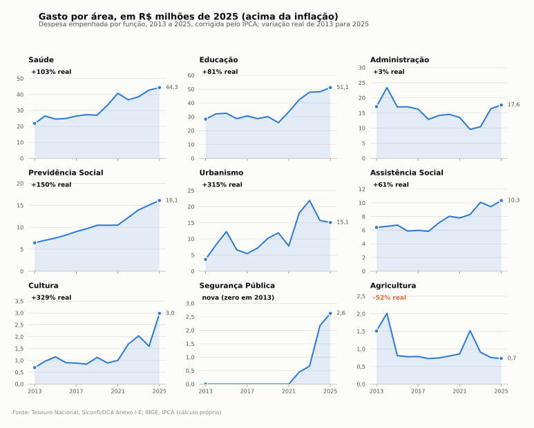
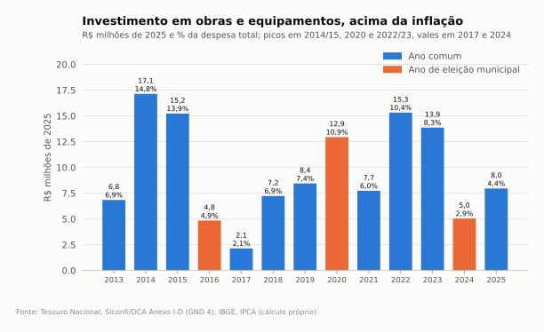

# Gasto por área ao longo do tempo, acima da inflação (2013 a 2025)

Todos os valores estão em **R$ de 2025**, corrigidos pelo IPCA médio anual (IBGE, SIDRA tabela 1737, https://sidra.ibge.gov.br/tabela/1737). A base é a despesa empenhada por função do Siconfi/DCA Anexo I-E (https://siconfi.tesouro.gov.br), já usada em [despesas.md](despesas.md). Cálculo próprio em [`scripts/gasto_real.py`](../scripts/gasto_real.py). Dados: [`dados/gasto_real_por_funcao_2013_2025.csv`](dados/gasto_real_por_funcao_2013_2025.csv) e [`dados/investimentos_real_2013_2025.csv`](dados/investimentos_real_2013_2025.csv).

Cuidados de leitura:
- O "gasto por função" é tudo o que a área consome: salário, custeio e obra. O **investimento** propriamente dito (obras e equipamentos, GND 4) o Siconfi só dá no total, sem abrir por área. Por isso as duas coisas aparecem separadas.
- 2013 não inclui despesas intraorçamentárias; de 2014 a 2017 o DCA não as separa. A diferença é pequena (a contribuição patronal ao RPPS), mas infla um pouco 2014 a 2017.
- Por habitante, a conta usa as estimativas do IBGE e o Censo 2022; 2023 foi interpolado.

## Tabela: R$ milhões de 2025

| Área | 2013 | 2017 | 2021 | 2023 | 2025 | Variação real 2013 a 2025 | Por habitante 2013 | Por habitante 2025 |
|---|---|---|---|---|---|---|---|---|
| **Total** | 94,4 | 101,1 | 121,1 | 154,0 | 170,0 | **+80%** (5,0% a.a.) | R$ 4.089 | R$ 6.816 |
| Educação | 28,3 | 30,7 | 33,6 | 47,8 | 51,1 | +81% | R$ 1.225 | R$ 2.050 |
| Saúde | 21,9 | 26,5 | 40,8 | 38,6 | 44,3 | +103% | R$ 947 | R$ 1.777 |
| Administração | 17,1 | 16,3 | 13,5 | 10,4 | 17,6 | +3% | R$ 740 | R$ 707 |
| Previdência (RPPS) | 6,4 | 9,0 | 10,5 | 14,0 | 16,1 | +150% | R$ 279 | R$ 645 |
| Urbanismo | 3,6 | 5,5 | 7,8 | 21,9 | 15,1 | +315% | R$ 158 | R$ 605 |
| Assistência social | 6,4 | 6,0 | 7,8 | 10,1 | 10,3 | +61% | R$ 277 | R$ 415 |
| Cultura | 0,7 | 0,9 | 1,0 | 2,0 | 3,0 | +329% | R$ 30 | R$ 120 |
| Segurança pública | 0 | 0 | 0 | 0,7 | 2,6 | nova | R$ 0 | R$ 105 |
| Legislativo (Câmara) | 2,8 | 2,6 | 2,2 | 2,1 | 2,6 | -6% | R$ 121 | R$ 106 |
| Desporto e lazer | 1,3 | 1,3 | 0,7 | 1,4 | 1,7 | +27% | R$ 57 | R$ 67 |
| Gestão ambiental | 1,0 | 0,5 | 0,1 | 0,8 | 1,4 | +48% | R$ 42 | R$ 57 |
| Transporte | 0 | 0 | 0 | 1,4 | 1,3 | nova | R$ 0 | R$ 53 |
| Agricultura | 1,5 | 0,8 | 0,9 | 0,9 | 0,7 | **-52%** | R$ 65 | R$ 29 |
| Habitação | 0,15 | 0 | 0 | 0 | 0 | zerada | R$ 7 | R$ 0 |

## Média anual por mandato (R$ milhões de 2025)

| Área | 2013 a 2016 (Miderson, PSDB) | 2017 a 2020 (Bola, PSDB) | 2021 a 2024 (Éder, PP) | 2025 (Éder, 2º mandato) |
|---|---|---|---|---|
| Total | 104,8 | 104,0 | 143,2 | 170,0 |
| Educação | 30,4 | 28,8 | 43,0 | 51,1 |
| Saúde | 24,5 | 28,5 | 39,7 | 44,3 |
| Urbanismo | 7,7 | 8,7 | 15,9 | 15,1 |
| Previdência | 7,3 | 9,9 | 12,9 | 16,1 |
| Assistência social | 6,4 | 6,7 | 8,9 | 10,3 |
| Administração | 18,6 | 14,5 | 12,5 | 17,6 |
| Cultura | 0,9 | 0,9 | 1,6 | 3,0 |
| Segurança pública | 0 | 0 | 0,8 | 2,6 |
| Agricultura | 1,3 | 0,8 | 1,0 | 0,7 |
| **Investimentos (GND 4)** | **11,0** | **7,7** | **10,5** | **8,0** |

Prefeitos por mandato conforme [../04-politica/dados/prefeito_1996_2024.csv](../04-politica/dados/prefeito_1996_2024.csv) (TSE).

## Investimento em obras e equipamentos

| Ano | R$ milhões de 2025 | % da despesa | Por habitante |
|---|---|---|---|
| 2013 | 6,8 | 6,9% | R$ 297 |
| 2014 | 17,1 | 14,8% | R$ 741 |
| 2015 | 15,2 | 13,9% | R$ 657 |
| 2016 | 4,8 | 4,9% | R$ 209 |
| 2017 | 2,1 | 2,1% | R$ 92 |
| 2018 | 7,2 | 6,9% | R$ 312 |
| 2019 | 8,4 | 7,4% | R$ 364 |
| 2020 | 12,9 | 10,9% | R$ 557 |
| 2021 | 7,7 | 6,0% | R$ 332 |
| 2022 | 15,3 | 10,4% | R$ 629 |
| 2023 | 13,9 | 8,3% | R$ 564 |
| 2024 | 5,0 | 2,9% | R$ 203 |
| 2025 | 8,0 | 4,4% | R$ 319 |

## Leitura (análise)

1. **O orçamento cresceu de verdade, não só no papel.** Descontada a inflação, a Prefeitura gasta 80% mais que em 2013, e 67% mais por habitante. O salto vem de 2021 em diante. Ele acompanha a alta das transferências (FPM, ICMS e o novo FUNDEB, ver [receitas.md](receitas.md)). É mais efeito de receita do que escolha de um governo específico.
2. **Saúde e educação puxaram o crescimento.** A saúde dobrou em termos reais e deu o salto em 2020 e 2021 (pandemia e repasses do SUS). A educação ficou parada de 2013 a 2020 (cerca de R$ 29 a 31 mi) e subiu quase 70% entre 2020 e 2025. Isso coincide com o novo FUNDEB (Lei 14.113/2020), que exige 70% para profissionais da educação e aumentou a complementação da União.
3. **Urbanismo quadruplicou.** Foi de R$ 3,6 mi para R$ 15 mi, com pico de R$ 21,9 mi em 2023 (recapeamento, iluminação e obras urbanas). É a área que mais reflete escolha do governo atual.
4. **A previdência própria é a área que cresce mais rápido entre as grandes: +150%, ou 7,9% ao ano acima da inflação.** É o aporte ao RPPS (Capstuba) e confirma o risco já apontado em [contas-e-tce.md](contas-e-tce.md): o custo do passivo atuarial cresce sozinho e disputa espaço com as outras áreas.
5. **Áreas novas: segurança e transporte.** A Guarda Municipal, depois "Polícia Municipal", aparece no orçamento a partir de 2022 e chega a R$ 2,6 mi em 2025. O transporte (ônibus da Tarifa Zero) aparece a partir de 2023.
6. **Cultura cresceu muito, mas a partir de uma base minúscula.** Foi de R$ 0,7 mi para R$ 3,0 mi, só 1,8% do gasto. A origem do salto de 2025 (verba própria ou repasse federal da Lei Paulo Gustavo/PNAB) está tratada em [../07-cultura/](../07-cultura/).
7. **A agricultura perdeu metade, num município cuja economia é agro.** O gasto caiu de R$ 1,5 mi para R$ 0,7 mi reais (R$ 29 por habitante). Parte do apoio ao produtor pode estar lançada em Transporte ou Urbanismo (estradas rurais), mas a função específica encolheu.
8. **Habitação tem gasto municipal zero desde 2014.** As 253 casas da CDHU entregues em 2026 foram pagas pelo Estado. A contrapartida do município, se houve, não passa pela função Habitação. Ver [../03-bairros/habitacao-popular.md](../03-bairros/habitacao-popular.md).
9. **O investimento é baixo e oscila muito.** A média ficou entre R$ 8 e 11 mi por ano em todos os mandatos. Não há ciclo eleitoral claro: houve pico em 2020 (eleição), mas 2016 e 2024, também anos de eleição, ficaram entre os mais baixos da série. Os picos de 2014 e 2015 e de 2022 e 2023 parecem ligados a convênios e operações de crédito pontuais. Em 2025 entraram R$ 18 mi do FINISA como receita, mas o investimento empenhado foi só R$ 8 mi; o resto deve aparecer em 2026.
10. **Administração e Câmara caíram em peso relativo.** Ficaram estáveis em reais enquanto o total crescia 80%. Isso libera espaço para as áreas finalísticas.
