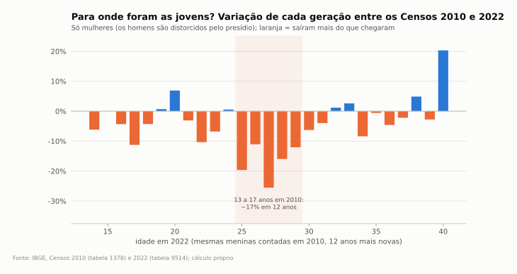
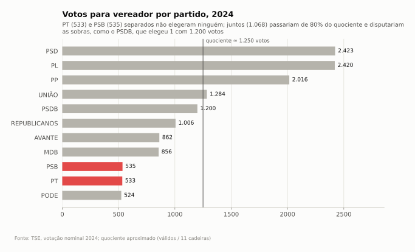
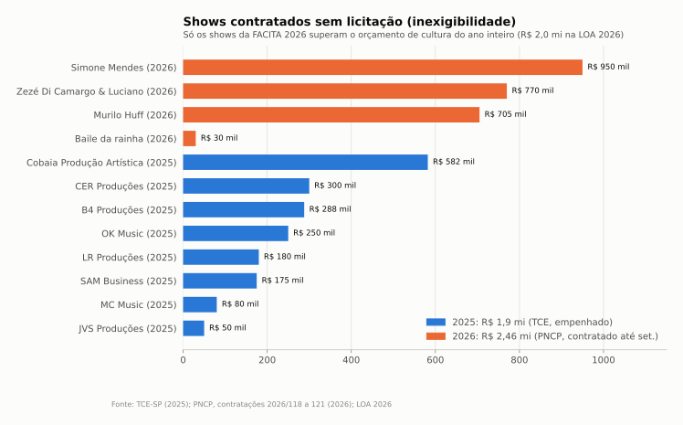

# Estratégia: uma candidatura de futuro para Taquarituba

Documento de trabalho, outubro de 2026. Cruza o dossiê inteiro (pastas 01 a 07) com a pergunta: **onde estão as brechas para uma candidatura nova, de esquerda, com proposta de futuro, numa cidade conservadora, agro e envelhecida, num horizonte de até 12 anos?**

Tudo aqui é **análise** sobre os dados das outras pastas, que têm as fontes. Estudos de apoio nesta pasta:
- [universidade.md](universidade.md): viabilidade de ensino superior público na cidade.
- [empregos-e-incentivos.md](empregos-e-incentivos.md): o que a Prefeitura pode fazer, dentro da lei, para atrair empregos de 5 salários mínimos ou mais.

---

## 1. O terreno em 10 números

| # | Fato | Fonte no repo |
|---|---|---|
| 1 | A população não cai: cresce 0,7% ao ano (0,3% sem o presídio). O que cai são os nascimentos: de 384 em 2000 para 270 em 2025. | 01-demografia |
| 2 | **Os jovens saem.** Das meninas que tinham 13 a 17 anos em 2010, 17% não estavam mais na cidade em 2022. São cerca de 35 jovens de 18 a 29 anos a menos por ano. | 08-estrategia/universidade.md |
| 3 | Só **11,5%** dos moradores de 25 a 34 anos têm diploma universitário (estado: 28,2%; Avaré: 21,1%). É o pior índice da região. | 08-estrategia/universidade.md |
| 4 | O PIB per capita é o maior da região (R$ 52,5 mil), mas **o salário médio formal está parado em 2 salários mínimos há 20 anos** e só 5% dos ocupados ganham mais de 5 SM (estado: 10,2%). | 02-economia, empregos-e-incentivos.md |
| 5 | Eleitorado de 18 mil: 25% com 60 anos ou mais, 43% com no máximo o fundamental. Cerca de dois terços votam na direita nas eleições nacionais e a esquerda tem um piso de um terço. | 04-politica |
| 6 | Éder Miano (PP) foi reeleito com 58%; **42% votaram contra**, mas a oposição organizada hoje é de centro-direita (PSD, União, PSDB). | 04-politica |
| 7 | **Nos bairros pobres, o eleitor vota mais na esquerda para presidente e mais no Éder para prefeito.** Lula venceu em 2022 no terço mais pobre (53%), onde Éder teve 64% em 2024. | 04-politica/voto-por-renda.md |
| 8 | **Em 2024 a esquerda quase elegeu um vereador.** Tio da Vila (PT) foi o 8º mais votado (407 votos) e ficou de fora porque a chapa não atingiu o quociente (cerca de 1.250 votos). A federação do PT teve 533 votos e o PSB 535. Juntos (1.068) teriam passado de 80% do quociente e disputado as sobras, como o PSDB, que elegeu 1 vereador com 1.200 votos. | 04-politica/dados |
| 9 | A Câmara é governista e passiva: a Mesa toda é da base e 80% das leis vêm do Executivo. | 04-politica/prefeitura-e-camara.md |
| 10 | A Prefeitura depende de repasses para 80% da receita, a previdência própria cresce 8% ao ano acima da inflação e o gasto com agricultura caiu pela metade desde 2013. | 05-financas-publicas |

## Gráficos-chave

## 2. A tese central

A cidade é rica e quem mora nela não fica com essa riqueza. O agro produz, o PIB cresce acima do estado, mas o salário não sai de 2 mínimos, quase ninguém tem faculdade e os filhos vão embora para estudar e trabalhar. **A pauta de futuro (universidade, emprego qualificado, juventude) é ao mesmo tempo a pauta da família conservadora que viu o neto partir.** Esse é o ponto de encontro entre um projeto de esquerda e um eleitorado de direita.

## 3. O problema do rótulo (leia antes de tudo)

Leitura direta dos números: em Taquarituba, uma candidatura que se apresente como "extrema esquerda" sai com teto de cerca de um terço e fica vulnerável a ser reduzida ao rótulo. **A ruptura pode estar no conteúdo e no método, sem estar na embalagem.** Isso não é esconder posição: é escolher por onde a conversa começa.

| Tende a afastar este eleitorado | Tende a aproximar |
|---|---|
| "disruptivo", "ruptura", "revolução" | "virar a página", "nova geração", "fazer a cidade segurar os filhos" |
| ataque ao agro | "o agro daqui merece faculdade, técnico e salário daqui" |
| pauta nacional e identitária no centro | pauta local, concreta, com número |
| "contra o Éder" como identidade | "contra a política de sempre", com fiscalização documentada |
| promessa grande sem custo | proposta com conta, prazo e fonte de dinheiro |

"Futuro" não é palavra proibida. O risco é parecer abstrato. "Futuro" com cara de **faculdade, emprego e neto em casa** é conservador no melhor sentido.

## 4. Brechas concretas

### 4.1 Juventude e ensino superior (a bandeira principal)
- A cidade já tem polo da **Univesp** e uma **Etec** no mesmo prédio. A faculdade pública presencial mais próxima é o IFSP de Avaré, a 63 km.
- **Fatec só para Taquarituba tem chance baixa.** O Estado fala em público de cerca de 100 mil habitantes. **Fatec regional por consórcio tem chance média:** os 11 municípios a até 55 km somam 132 mil habitantes e há precedente no CIVAP em 2026. Detalhes em [universidade.md](universidade.md).
- Ganhos rápidos, que a oposição já pode cobrar: **transporte universitário gratuito** para Avaré, Itapeva e Ourinhos, ampliação de vagas e cursos do polo Univesp, e cursos técnicos agro na Etec.
- Formato de campanha: **"Faculdade em Taquarituba"** como movimento suprapartidário (abaixo-assinado, audiência pública, carta dos 11 prefeitos e vereadores da região). Uma causa que a base do governo não consegue ser contra.

### 4.2 Emprego de 5 salários mínimos ou mais
- Setores que pagam isso em SP e cabem numa cidade agro: **sementes (5,3 SM), atacado de máquinas agrícolas (5,1), energia (6,1), TI (7,7)**. Frigorífico paga 2,4. Ver [empregos-e-incentivos.md](empregos-e-incentivos.md).
- O município pode dar IPTU, ITBI, taxas, área no distrito industrial e infraestrutura. Não pode ir abaixo de 2% de ISS nem mexer no ICMS. Desde 2026 a LRF exige **metas e prazo** para benefício fiscal.
- Proposta-bandeira (análise): **Lei do Emprego Qualificado.** O benefício só vale com contrapartida medida em número de vagas acima de 5 SM, tem prazo de até 5 anos e é cancelado se a meta não for cumprida, como Itapevi já faz com contrapartidas. Meta honesta: mirar em **vagas**, não na média, porque nem Pompéia (Jacto e Fatec) chega a 5 SM de média.
- Ligação com a universidade: a empresa de sementes, máquinas ou energia vem se houver técnico formado aqui.

### 4.3 O agro como aliado, não como adversário
- O gasto municipal com agricultura caiu 52% acima da inflação desde 2013: de R$ 65 para R$ 29 por habitante. **O governo do agro abandonou o agro no orçamento.** É um argumento para falar com produtor, cooperativa e sindicato rural.
- Proposta: assistência técnica, estrada rural, agricultura de precisão e energia solar e biogás para o pequeno produtor e o leiteiro. O leite cresceu 7 vezes desde 2010.

### 4.4 Fiscalização: a oposição que a Câmara não faz
- Fatos documentados que valem cobrança pública (sempre com o documento na mão):
  - As 253 casas da CDHU foram **pagas pelo Estado** (R$ 46,2 mi), num projeto que o próprio prefeito chamou de "inerte" em 2021. Em 2024 a Prefeitura respondeu a um vereador que o contrato "é com o governador", enquanto o material do prefeito fala em "250+ casas do Minha Casa Minha Vida". Ver [../03-bairros/habitacao-popular.md](../03-bairros/habitacao-popular.md).
  - **Planejamento nota C no TCE há 10 anos**, IEG-M caindo de B para C+, e Plano Diretor de 2006, vencido.
  - **Previdência dos servidores:** passivo de cerca de R$ 151 mi, que cresce todo ano.
  - **Empréstimo FINISA na reforma da Prefeitura.** Entraram R$ 18 mi do FINISA em 2025, mas só R$ 8 mi de investimento foram empenhados no ano. Do que foi usado em Urbanismo, R$ 1,25 mi foram para a "escadaria, estacionamento e reforma do Paço Municipal" (BMA Negócios, concorrência 94/2025), ou seja, dívida para reformar a sede do próprio governo. Perguntas: qual é o plano de uso dos R$ 25 mi autorizados (Lei 1.974/2025)? Quanto vai para obra na sede e quanto para os bairros? Ver [../05-financas-publicas/cultura-e-urbanismo-o-que-mudou.md](../05-financas-publicas/cultura-e-urbanismo-o-que-mudou.md).
  - **Obras e contratos para acompanhar:** aditivos de "acréscimos de serviços" na ligação de ruas da Maqterra (cerca de R$ 3,9 mi só em 2023); a troca da empresa de limpeza pública com dispensa de licitação em 2025, depois de um processo por abandono contratual.
  - A **CPI 001.2026** aparece no site da Câmara sem documento publicado.
  - **FACITA: ponto central de fiscalização.** Até 2024 a festa era de uma comissão local com promotora privada. Em 2025 a Prefeitura assumiu e passou a pagar com dinheiro próprio:
    - **Shows sem licitação.** Na base do TCE-SP de 2025, a função Cultura gastou R$ 3,03 mi, 100% de recurso do Tesouro municipal. Desse total, R$ 1,93 mi foram "festividades", com cerca de R$ 1,6 mi em shows contratados por inexigibilidade: Cobaia R$ 582 mil, CER R$ 300 mil, B4 R$ 288 mil, OK Music R$ 250 mil, LR R$ 180 mil, SAM R$ 175 mil, MC Music R$ 80 mil. A cultura dobrou em 2025 por causa disso.
    - **Organizadora invisível.** A empresa que organizou a feira (Organização Estrela Som, CNPJ 03.398.128/0001-43) foi homologada no PNCP por R$ 835,6 mil (pregão 50/2025), mas não aparece em nenhum empenho de 2025 da Prefeitura no TCE. Perguntas: o contrato foi pago? Por qual área, em que ano? Houve receita de bilheteria, camarote e praça de alimentação, e quem ficou com ela?
    - **Gasto espalhado.** A decoração de Natal (R$ 308 mil) foi lançada em Desporto e Lazer e um evento rural em Urbanismo, o que dificulta saber o custo real das festas.
    - **2026 maior ainda.** Só três shows nacionais da FACITA 2026 (Simone Mendes R$ 950 mil, Zezé Di Camargo & Luciano R$ 770 mil, Murilo Huff R$ 705 mil) somam R$ 2,4 mi, mais que o orçamento de cultura do ano (R$ 2,0 mi). Há ainda um registro de preços de estrutura de eventos com teto de R$ 52,35 mi.
    - **O contraste.** O fundo de turismo existe desde 1998 sem gasto, nenhum bem é tombado, a biblioteca não tem prédio próprio, e o resultado dos editais federais de cultura (R$ 736 mil desde 2020) não está publicado.
    - **A festa movimenta a cidade? Ninguém mediu.** Não há dado público de visitantes nem estudo de impacto. A Prefeitura só afirma que a feira "ajuda o comércio e o turismo". A entrada é gratuita ([Prefeitura, 29ª FACITA](https://www.taquarituba.sp.gov.br/noticia/2572/taquarituba-celebra-a-29-facita-com-grandes-atracoes-e-entrada-gratuita/); [Avaré Mais, 2025](https://avaremais.com.br/guia/avare/-/facita-2025-taquarituba/)), então o dinheiro não volta por bilheteria, só por camarote e praça de alimentação. Os cachês (R$ 1,6 mi em 2025, R$ 2,4 mi em 2026) vão para produtoras de fora. Na cidade fica o que o visitante gasta, e parte disso vai para ambulante, parque e camarote de fora. Pelo caixa a conta não fecha: os impostos e taxas próprios somam cerca de R$ 21 mi por ano e o ISS de 4 dias de festa não recupera R$ 2,6 mi. O retorno, se houver, está no faturamento do comércio e na imagem.
    - **Por que gastar pesado em 2025, ano sem eleição (hipóteses, nenhuma confirmada):**
      1. Resgate e data redonda: a edição de 2024 quase foi cancelada e a de 2025 era a 30ª.
      2. Visibilidade acumulada para 2026 (eleição de deputados, com aliados como Maurício Neves, PP, o federal mais votado na cidade) e 2028 (sucessão do Éder, que não pode concorrer).
      3. Agrado aos setores fortes: agro, comércio e lideranças da comissão.
      4. Concorrência com as festas das cidades vizinhas.
    - **Perguntas para a Prefeitura (Lei de Acesso à Informação):** estimativa de público e método de contagem; faturamento da praça de alimentação e dos camarotes e quem ficou com ele; quantos comerciantes eram de Taquarituba e quantos de fora; contrato e pagamento da organizadora; prestação de contas da festa (receitas e despesas); ISS e taxas arrecadados com o evento. **Se a Prefeitura não tiver esses números, esse já é o achado: R$ 2,6 mi gastos sem medir o retorno.** Se tiver e o retorno for bom, vira argumento para a "FACITA de conta aberta".
    - **Como fiscalizar:** pedir pela Lei de Acesso à Informação os processos de inexigibilidade (justificativa de preço e comparação com cachês em outras cidades), o contrato com a organizadora e a prestação de contas da festa (receitas e despesas); comparar cachês no PNCP de outras prefeituras; levar à Câmara e, se houver base, ao TCE.
    - **Como falar disso sem atacar a festa** (a FACITA é querida e agro): "a festa é do povo, a conta também tem que ser". Proposta: FACITA com prestação de contas pública, teto de cachê, cota para artista local e o mesmo valor investido em cultura o ano inteiro (música raiz, hip hop, Navegantes, biblioteca).
    - Fontes: [../07-cultura/gestao-e-incentivos.md](../07-cultura/gestao-e-incentivos.md), [PNCP 2025/50](https://pncp.gov.br/app/editais/46634218000107/2025/50), base de despesas do TCE-SP (https://transparencia.tce.sp.gov.br/conjunto-de-dados).
- Ferramentas: pedidos pela Lei de Acesso à Informação, acompanhamento do Diário Oficial, presença nas sessões e audiências do orçamento (LDO e LOA), denúncia ao TCE e ao MP quando houver base.
- **Cuidado com a cassação de 2022.** O TJ-SP a anulou por cerceamento de defesa e pelo voto do presidente da Câmara, que viraria prefeito. Usada como ataque, ela tende a virar a favor do Éder (o "perseguido" que venceu). Ver [../04-politica/prefeitura-e-camara.md](../04-politica/prefeitura-e-camara.md).

### 4.5 Os bairros onde a disputa se decide
- Vila Santa Rita, Vila São Vicente, Vila Ouro Branco, Parque São Roque e Aleixos têm a menor renda, a pior drenagem e o maior voto em Lula e no Éder ao mesmo tempo. Ver [../03-bairros/](../03-bairros/) e o mapa.
- Lá o voto municipal é de **entrega e presença**: quem resolveu o bueiro, a lombada, o ônibus da Tarifa Zero e o posto de saúde. A estratégia é estar lá todo mês, com pauta de bairro (drenagem, ESF na Santa Rita, creche), muito antes da eleição.

## 5. Rota de 12 anos (análise)

| Fase | Período | Objetivo | Como |
|---|---|---|---|
| **Base** | 2027 e 2028 | Virar referência local antes de virar candidato | Movimento "Faculdade em Taquarituba"; coletivo de jovens; fiscalização com pedidos de informação e boletim mensal do orçamento; presença fixa em 5 bairros |
| **Cabeça de ponte** | eleição de 2028 | Eleger 1 ou 2 vereadores | **Concentrar a esquerda numa única lista.** Coligação para vereador é proibida, então os candidatos precisam estar no mesmo partido ou federação (PT, PCdoB e PV já são federados; PSOL e Rede também; o PSB não). A chapa precisa de 8 a 11 candidatos de 100 a 250 votos cada e 1 ou 2 puxadores. Em 2024 a federação do PT teve 533 votos e o PSB 535. Somados (1.068), passariam de 80% do quociente e disputariam as sobras, como o PSDB, que elegeu 1 com 1.200 votos. Ver gráfico 25 |
| **Projeção** | 2029 a 2032 | Mandato de vereador como vitrine | Projetos de lei de transporte universitário, emprego qualificado e Plano Diretor; CPIs e fiscalização; prestação de contas pública |
| **Teste majoritário** | eleição de 2032 | Disputar a prefeitura ou compor como vice | Medir o teto. Pode ser aliança com parte da oposição de centro que rompeu com o Éder |
| **Disputa** | eleição de 2036 | Prefeitura | Candidatura jovem com 8 anos de presença, entrega como vereador e uma pauta da cidade (faculdade e emprego) |

Observações:
- O Éder não pode disputar um 3º mandato seguido em 2028. **2028 é eleição sem incumbente**, e a base dele vai rachar na sucessão. É o momento de entrar na Câmara, não de tentar a prefeitura.
- Pré-campanha é permitida (Lei 9.504/97, art. 36-A): pode divulgar ideias, posição e projetos, sem pedir voto explicitamente antes de 16 de agosto do ano eleitoral.
- Cuidado com abuso de poder econômico, uso de estrutura pública e propaganda antecipada. Prestação de contas limpa desde o primeiro real.

## 6. Mensagens-teste (para validar na rua antes de adotar)

- "Taquarituba produz riqueza e exporta os filhos."
- "Faculdade aqui, para o neto não precisar ir embora."
- "Emprego de verdade: quem ganha benefício da Prefeitura tem que pagar salário de verdade."
- "O agro sustenta a cidade e a Prefeitura cortou pela metade o que gasta com o agro."
- "Planejamento nota C há 10 anos: a cidade anda sem mapa."

**Como validar:** conversas de grupo em 3 ou 4 bairros e faixas de idade diferentes, e uma pesquisa por telefone simples (300 a 400 entrevistas) antes de 2028. Para divulgar, a pesquisa precisa de registro no TSE.

## 7. Riscos

| Risco | Mitigação |
|---|---|
| Ser reduzido a rótulo ("comunista", "contra o agro") | Pauta local com número, gente do agro e da igreja no movimento, porta-vozes diversos |
| Faculdade virar promessa vazia | Prometer o processo (consórcio, transporte, polo), com marcos datados, e não a inauguração |
| Incentivo fiscal virar renúncia sem retorno | Contrapartida, meta e cláusula de devolução por lei |
| Retaliação local (emprego, família, comércio) | Rede de apoio, transparência e documentação de tudo |
| Fragmentação da esquerda local | Acordo de chapa única com regra clara de ordem e recursos |
| A oposição de centro capturar o voto anti-Éder | Ocupar uma pauta que o centro não tem (juventude e faculdade) e propor aliança na sucessão |

## 8. Próximos passos de pesquisa

1. Pesquisa qualitativa (grupos) e quantitativa local.
2. Mapa de lideranças por bairro (associações, igrejas, clubes, cooperativas).
3. Pedidos de informação: FINISA, contratos, Tarifa Zero, previdência, CPI 001.2026.
4. Conversa com prefeitos e vereadores dos 11 municípios do entorno sobre a Fatec regional.
5. Dados de ENEM do município e matrículas do polo Univesp (não achamos online).
