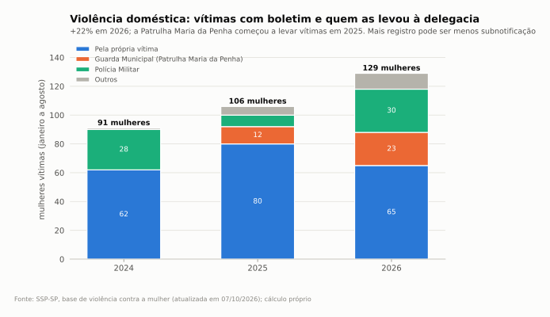
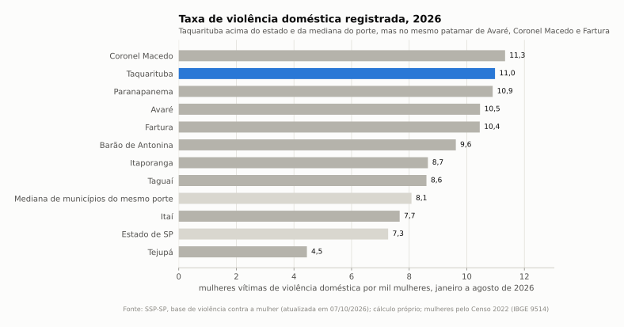

# Taquarituba (SP): políticas para mulheres em 2026

Gráficos gerados por [`scripts/graficos_mulheres.py`](../scripts/graficos_mulheres.py).

Levantamento de 23/10/2026. Pergunta: quantas mulheres os programas municipais de apoio atenderam em 2026 e se essas políticas são eficazes diante da demanda. Cada número nos arquivos tem fonte com URL e data e vem marcado como **[fato]**, **[cálculo]**, **[estimativa]** ou **[análise]**. Nenhum nome de vítima ou atendida foi publicado; o endereço do abrigo sigiloso foi omitido de propósito. Pesquisa feita com apoio de IA (Claude): confira na fonte antes de citar.

| Arquivo | Conteúdo |
|---|---|
| [estrutura-e-leis.md](estrutura-e-leis.md) | O que existe, quem executa, leis e decretos 2023 a 2026 |
| [atendimentos-2026.md](atendimentos-2026.md) | Números de 2026 por serviço, com grau de certeza |
| [gasto.md](gasto.md) | Gasto identificável 2021 a 2025 e estimativa de 2026 |
| [demanda-violencia.md](demanda-violencia.md) | Violência doméstica registrada (SSP-SP), SINAN, comparação com o Estado, vulnerabilidade |
| [pedidos-lai.md](pedidos-lai.md) | Nove pedidos de LAI prontos para fechar as lacunas |
| `dados/` | CSVs: atendimentos 2026, leis, gasto, empenhos AMVAPA 2026, vítimas SSP 2024 a 2026, taxas comparadas, ocorrências 2019 a 2026, SINAN, coletas de preventivo |

---

## 1. O que existe

Não há secretaria nem coordenadoria da mulher. A política está espalhada entre Ação Social, Segurança Pública e Saúde, e quase tudo nasceu entre set/2025 e jun/2026 **[fato]**:

- **Conselho e Fundo Municipal dos Direitos da Mulher**: LC 377, de 15/10/2025; conselho de 8 membros nomeado em 30/10/2025 e recomposto em 20/05/2026. Sem atas, plano ou execução do fundo publicados.
- **Patrulha Maria da Penha** da GCM (Polícia Municipal): ativa desde ao menos 2025. **Projeto Guardiã Maria da Penha**, Lei 2.011, de 17/06/2026: visitas a mulheres com medida protetiva indicadas pelo Ministério Público, junto com o CREAS. Não encontrei o termo com o MP que a lei exige.
- **SAI Mulheres**: abrigo regional sigiloso para mulheres em situação de violência e filhos, sediado em Taquarituba, para 12 municípios, inaugurado em 04/02/2026; executado pela Casa da Criança de Taquarituba via consórcio AMVAPA; R$ 659,2 mil do Estado para implantar.
- **CREAS** (PAEFI e grupo Rede Mulher), **três CRAS** (grupos de mulheres no PAIF), **Saúde** (Outubro Rosa com horário ampliado, Encontro de Gestantes), prioridade em creche para filhos de mulheres em situação de violência (Portaria CME 40/2025).
- **Estado**: auxílio-aluguel de R$ 500 por mês (Taquarituba aparece entre os municípios ofertantes), Cabine Lilás no 190. **Não há DDM** no município: os casos vão à Delegacia de Polícia de Taquarituba.

## 2. Quantas foram atendidas em 2026

**Não existe número oficial publicado de mulheres atendidas.** O que os dados públicos permitem dizer:

| Indicador 2026 | Número | Tipo e certeza |
|---|---|---|
| Mulheres vítimas de violência doméstica que chegaram à delegacia (jan-ago) | **129** | cálculo, alta (SSP-SP) |
| Dessas, levadas pela GCM / Patrulha Maria da Penha | **23** | cálculo, alta como piso |
| Gestantes no Encontro de Gestantes (set) | **65** kits | fato, média |
| Coletas de Papanicolau no SUS (jan-jul) | **480** coletas | cálculo, alta para o registro |
| Alunos na palestra da Patrulha (13/03) | ~150 | fato, média |
| Outubro Rosa 2026 | 500 a 900 coletas | estimativa, baixa |
| Auxílio-aluguel estadual | 5 a 12 mulheres | estimativa, baixa |
| Famílias do Bolsa Família chefiadas por mulheres | cerca de 990 | estimativa, média |
| Abrigo SAI Mulheres, CREAS, Rede Mulher, visitas da Guardiã | sem número | lacuna, só por LAI |

Os itens se sobrepõem; não somar.

## 3. Quanto se gasta

- Gasto identificável e específico com mulheres (empenhado): R$ 13 mil (2021), R$ 10 mil (2022), R$ 43 mil (2023), R$ 37 mil (2024) e **R$ 188 mil (2025)** **[cálculo, TCE-SP]**.
- O salto de 2025 é o SAI Mulheres: R$ 153 mil (aluguel do imóvel e rateio ao consórcio), cerca de 85% com recurso estadual **[cálculo]**. Sem o abrigo, sobram R$ 35 mil em campanhas, brindes e material de Outubro Rosa.
- R$ 188 mil são 0,12% da despesa da Prefeitura e cerca de R$ 16 por mulher residente por ano **[cálculo]**.
- 2026: a API do TCE não traz histórico; estimo **R$ 110 mil a R$ 150 mil** no ano, dos quais R$ 77 mil a R$ 110 mil para o SAI **[estimativa, confiança baixa]**.
- Folha de CRAS, CREAS, GCM e saúde não entra: não há ação orçamentária para mulheres na LOA.

## 4. Demanda contra oferta

| | 2024 | 2025 | 2026 (jan-ago) |
|---|---|---|---|
| Mulheres vítimas de violência doméstica (SSP-SP) | 134 | 182 | 129 (cerca de 190 no ano, estimativa) |
| Vítimas por mil mulheres, jan-ago: Taquarituba | 7,75 | 9,02 | **10,98** |
| Idem, Estado de SP | 5,83 | 6,34 | 7,27 |
| Levadas à delegacia pela GCM | 0 | 30 | 23 |
| Descumprimento de medida protetiva | 17 | 33 | 13 |
| Notificações de violência interpessoal contra mulheres no SINAN | 7 | 14 | n.d. |

**[cálculo; fontes em demanda-violencia.md]** A taxa de Taquarituba em 2026 é 51% maior que a do Estado e 36% maior que a mediana de municípios paulistas do mesmo porte.

## 5. Eficácia (análise)

1. **A demanda é real e crescente, e a oferta é medida só pela metade.** São cerca de 190 mulheres por ano com boletim de violência doméstica, numa cidade de 11,7 mil mulheres. O município criou peças certas (conselho, patrulha, abrigo, lei da Guardiã), mas não publica quantas mulheres acompanha. Sem esse número, não se mede cobertura. **[análise]**
2. **A Patrulha Maria da Penha é o programa com sinal mais claro.** A GCM passou de zero casos levados à delegacia (2024) para 30 (2025) e responde por 18% das vítimas de 2026. A alta de 2026 nos registros, puxada por lesão corporal (25 para 53 no comparativo jan-ago), é compatível com mais detecção, não só mais violência. **[análise]**
3. **O abrigo resolve uma lacuna regional, mas é estadual na prática.** O município paga pouco e não controla metas; a cobertura para Taquarituba depende de quantas vagas sobram para as outras 11 cidades. **[análise]**
4. **O elo fraco é a saúde e a prevenção.** A rede de saúde notificou 14 casos em 2025 para 182 vítimas na polícia; a notificação é a porta de entrada do CREAS. As coletas de preventivo caíram 30% no primeiro semestre de 2026 frente a 2025 (pode ser atraso de registro). **[análise]**
5. **Política de calendário, pouca política de serviço.** Fora o abrigo, o gasto identificável é camiseta, folder, caneca e lanche. Conselho e fundo existem desde out/2025, mas não há plano municipal, meta nem ação orçamentária. **[análise]**
6. **Veredito provisório**: estrutura recente e no caminho certo, eficácia **não demonstrável** com dado público. A Guardiã depende de um termo com o MP que não foi localizado. O passo mais barato e de maior efeito é publicar um painel trimestral (CREAS, Patrulha, SAI, auxílio-aluguel) e criar uma ação "Políticas para as Mulheres" na LOA 2027. **[análise]**

## 6. Lacunas

- Atendimentos do CREAS (RMA), do SAI Mulheres, da Rede Mulher, visitas da Guardiã e auxílio-aluguel por município: pedir por LAI (`pedidos-lai.md`, pedidos 1, 2, 3, 5 e 9).
- Atas e plano do conselho; execução do fundo; termo de cooperação com o MP (pedidos 4 e 8).
- Medidas protetivas por comarca: tramitam em segredo e não aparecem no DataJud público; painel do CNJ em Power BI não extraído (pedido 7).
- Ligue 180 por município, CadÚnico por sexo do responsável, mães solo e renda feminina no Censo 2022: não extraídos (portal do MDS fora do ar em 23/10/2026).
- Diário Oficial de 2026 e PPA 2026-2029: o portal da Prefeitura ficou fora do ar a partir das 14h de 23/10/2026; só os diários de out/2025 foram lidos.
- Instagram e Facebook oficiais: não carregam sem login.
- Gasto de 2026 por função: o arquivo em massa do TCE-SP de 2026 ainda não foi publicado (404 em 23/10/2026).
- A data da Lei 2.011 diverge: 17/06/2026 no PDF assinado, 17/07/2026 na lista da Câmara (e em `04-politica/leis-aprovadas.md`).
